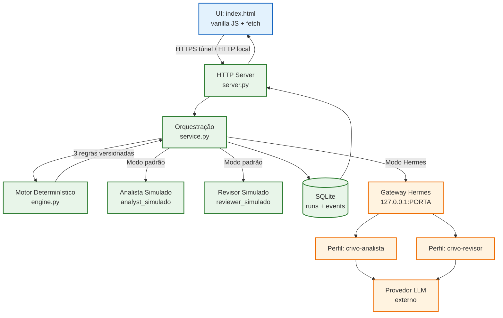
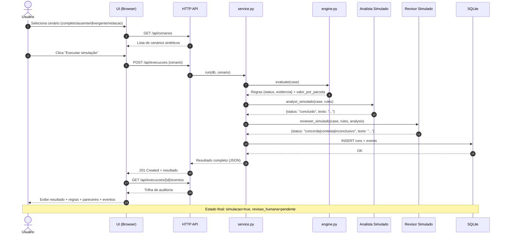

# Crivo Crédito PF — POC Local (Demo)

> **SIMULAÇÃO**: exclusivamente dados sintéticos; **não concede, nega ou recomenda crédito**. Toda execução exige revisão humana. Política demonstrativa sem limiares bancários; verifica presença, positividade e consistência entre valor e total declarado. A divisão por parcelas é apenas aritmética sem juros, **não é uma oferta**.

---

## 🔗 Sistema Online (Demo)

**https://such-transactions-neither-carlo.trycloudflare.com/ui**

> ⚠️ Túnel temporário via Cloudflare (sem autenticação). Subdomínio aleatório, não persistente.

---

## 📊 Diagramas

### Arquitetura (Visão Geral)



### Diagrama de Componentes (Container View)

```mermaid
flowchart TB
    %% Usuário
    User[👤 Usuário<br/>Analista / QA]
    
    %% Sistema Local
    subgraph Local["🖥️ Sistema Local (127.0.0.1:8000)"]
        Web[🌐 Web App<br/>Python + HTML/JS<br/>ThreadingHTTPServer]
        API[🔌 API REST<br/>http.server<br/>/cenarios, /execucoes]
        SVC[⚙️ Orquestração<br/>service.py<br/>Coordena fluxo completo]
        Engine[🧮 Motor de Regras<br/>engine.py<br/>3 regras v1.0 determinísticas]
        Analyst[🤖 Analista Simulado<br/>função Python<br/>Parecer conclusivo]
        Reviewer[🔍 Revisor Simulado<br/>função Python<br/>Concorda/Contesta/Inconclusivo]
        DB[(💾 SQLite<br/>crivo.sqlite3<br/>runs + events)]
    end
    
    %% Modo Hermes Opt-in
    subgraph Hermes["🔧 Modo Hermes Opt-in (externo)"]
        Gateway[🚪 Gateway Hermes<br/>Go/HTTP<br/>Loopback only]
        ProfileA[👤 Perfil: crivo-analista<br/>System prompt + config]
        ProfileR[👤 Perfil: crivo-revisor<br/>Recebe parecer analista]
        Provider[☁️ Provedor LLM<br/>OpenAI/Anthropic/etc<br/>Não verificado pela POC]
    end

    %% Conexões - Modo Padrão
    User -->|HTTPS túnel / HTTP| Web
    Web -->|Fetch JSON| API
    API -->|run(cenario)| SVC
    SVC -->|Avalia regras| Engine
    Engine -->|Regras + valor/parcela| SVC
    SVC -->|Modo padrão| Analyst
    SVC -->|Modo padrão| Reviewer
    SVC -->|Persiste| DB
    API -->|Consulta| DB
    DB -->|Retorna| API
    API -->|201 + JSON| Web
    Web -->|Renderiza| User

    %% Conexões - Modo Hermes
    SVC -.->|HTTP POST /chat/completions<br/>Modo Hermes| Gateway
    Gateway -.->|Roteia| ProfileA
    Gateway -.->|Roteia| ProfileR
    ProfileA -.->|Completion| Provider
    ProfileR -.->|Completion| Provider

    %% Estilos
    classDef user fill:#f3e5f5,stroke:#7b1fa2,stroke-width:2px;
    classDef local fill:#e8f5e9,stroke:#2e7d32,stroke-width:2px;
    classDef hermes fill:#fff3e0,stroke:#ef6c00,stroke-width:2px,stroke-dasharray: 5 5;
    classDef db fill:#e0f2f1,stroke:#00695c,stroke-width:2px;
    classDef ext fill:#fce4ec,stroke:#c2185b,stroke-width:2px;
    
    class User user;
    class Web,API,SVC,Engine,Analyst,Reviewer local;
    class DB db;
    class Gateway,ProfileA,ProfileR hermes;
    class Provider ext;
```

### Fluxo de Execução (Sequence Diagram)



---

## 🔄 Fluxo Completo

### 1. Seleção de Cenário
O usuário escolhe um de 4 cenários sintéticos fixos:
| ID | Título | Descrição |
|----|--------|-----------|
| `completo` | Completo e consistente | Todos os campos presentes, valores válidos, total = valor × parcelas |
| `ausente` | Dados ausentes | Campos `valor` e `total_declarado` são `null` |
| `divergente` | Total divergente | `total_declarado` (900) ≠ `valor` (1000) |
| `violacao` | Parcelas inválidas | `parcelas = 0` (divisão por zero) |

### 2. Motor Determinístico (`engine.py`)
Avalia 3 regras versionadas (`politica: demonstrativa-1.0`):
1. **Presença dos campos** — todos os campos obrigatórios existem
2. **Valores inteiros positivos** — `valor > 0`, `parcelas > 0`, `total_declarado > 0`
3. **Consistência aritmética** — `valor × parcelas == total_declarado`

Saída: lista de regras com `status` (`observado`/`violado`) + `evidencia` + `valor_por_parcela` (divisão simples, sem juros).

### 3. Analista Simulado
Recebe cenário + regras. Retorna:
- `status: "concluido"`
- `texto`: resumo das inconsistências ou "nenhuma inconsistência nas regras demonstrativas; isso não é decisão de crédito"

### 4. Revisor Simulado
Recebe cenário + regras + parecer do analista. Retorna:
- `status: "concorda" | "contesta" | "inconclusivo"`
- `texto`: acompanha regras ou aponta pontos para revisão humana ("concordância não prova correção")

### 5. Estado Final
```json
{
  "simulacao": true,
  "aviso": "Simulação exclusivamente sintética. Não é decisão de crédito.",
  "estado": "revisao_humana",
  "revisao_humana": "pendente",
  "adaptadores": { "analista": "simulado_local", "revisor": "simulado_local" }
}
```

### 6. Persistência e Auditoria (SQLite)
- **runs**: resultado completo (JSON)
- **events**: trilha imutável* de cada etapa:
  `cenario_selecionado → regras_executadas → analista → revisor → revisao_humana_necessaria`
- *Registro local editável; não há garantia de imutabilidade.

---

## 🏗️ Arquitetura

```
crivo-credito-demo/
├── crivo/
│   ├── __init__.py          # "POC local, exclusivamente sintética."
│   ├── engine.py            # Motor determinístico (regras + cálculo)
│   ├── service.py           # Orquestração: casos, analista, revisor, persistência
│   ├── server.py            # HTTP server (ThreadingHTTPServer, 127.0.0.1:8000)
│   ├── hermes.py            # Cliente opcional gateway Hermes (opt-in)
│   ├── index.html           # UI single-page (vanilla JS, fetch API)
│   └── run_server.py        # Entry point (sys.path fix)
├── demo.py                  # Script alternativo (não usado no demo)
├── test_origin_regression.py
├── verify.py
├── .gitignore
└── README.md
```

### Modos de Execução

| Modo | Analista | Revisor | Dependências |
|------|----------|---------|--------------|
| **simulado** (padrão) | Função Python local | Função Python local | Nenhuma (stdlib + SQLite) |
| **hermes** (opt-in) | HTTP → Gateway Hermes (`crivo-analista`) | HTTP → Gateway Hermes (`crivo-revisor`) | Gateway rodando em loopback, `CRIVO_HERMES_CHAVE_*`, `CRIVO_HERMES_PORTA` |

> No modo Hermes: a aplicação **não atesta o modelo efetivo**; isolamento e retenção dependem da configuração do gateway. Falha → parecer de falha + revisão humana pendente, **sem fallback automático**.

---

## 🚀 Executar Localmente

```bash
# Pré-requisitos: Python 3.10+
cd /opt/data/projects/crivo-credito-demo/crivo
python3 run_server.py
# Servidor em http://127.0.0.1:8000
# UI: http://127.0.0.1:8000/ui
# API: http://127.0.0.1:8000/api/cenarios
```

### Testar via API
```bash
# Listar cenários
curl http://127.0.0.1:8000/api/cenarios

# Executar simulação
curl -X POST http://127.0.0.1:8000/api/execucoes \
  -H "Content-Type: application/json" \
  -d '{"cenario": "completo"}'

# Ver resultado + eventos
curl http://127.0.0.1:8000/api/execucoes/{id}
curl http://127.0.0.1:8000/api/execucoes/{id}/eventos
```

---

## 🔒 Segurança e Limitações

- **Zero dados reais** — catálogo sintético fixo, sem CPF, sem documentos
- **Regras versionadas e imutáveis** — agentes não alteram resultados do motor
- **Concordância ≠ correção** — revisor apenas acompanha regras demonstrativas
- **Human-in-the-loop obrigatório** — estado final sempre `revisao_humana: pendente`
- **Origem rastreada** — `adaptadores.analista/revisor` mostra `simulado_local` ou `adaptador_hermes_..._modelo_nao_verificado`
- **Sem fallback automático** — falha do analista/revisor → revisão humana
- **Não exponha serviços** — roda em `127.0.0.1:8000`; túnel só para demo temporário
- **Sem autenticação/autorização** — POC não endurecida para rede
- **Não validada juridicamente/regulatoriamente** — não usar com dados reais ou decisões efetivas

---

## 📝 Licença

POC experimental para fins de demonstração e estudo. Sem garantias.

---

**Desenvolvido por Rodrigo Abreu** — [LinkedIn](https://www.linkedin.com/in/rodrigosabreu/)